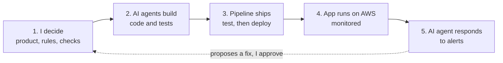
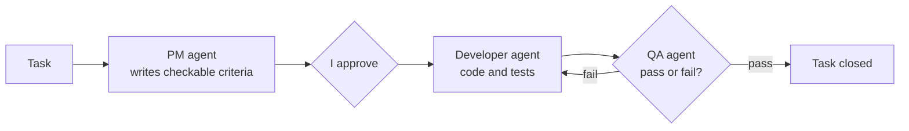
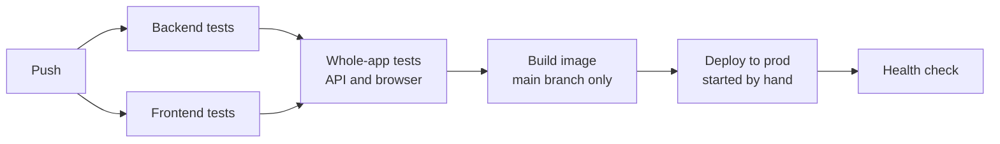
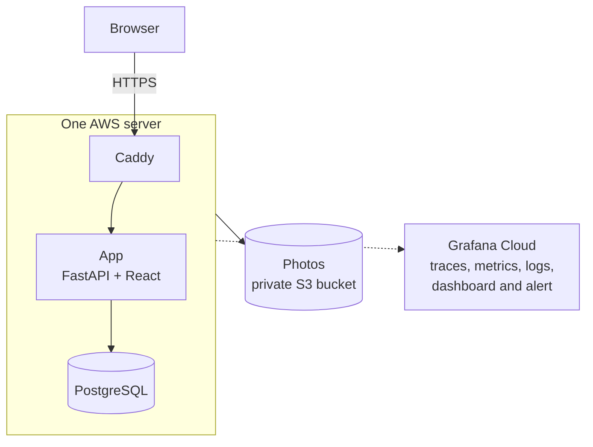
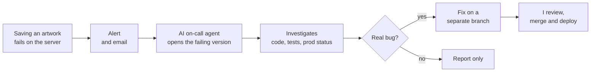

# ArtMneme

**I directed a team of AI agents to build, deploy and monitor a full web app. I made every decision; the agents wrote the code. I have no recent programming experience in app or web development.**

> The source code is private because the app may be released commercially. Read access and a walkthrough are available on request.

## In 30 seconds

- **The app:** a personal artwork collection. Save artworks you have seen, with photos and notes, and explore how they relate.
- **Built by AI agents** working as a small team: product manager, developer and tester.
- **Deployed on AWS** with automated tests, monitoring and alerts.
- **An AI on-call agent** investigates alerts and proposes fixes. It cannot deploy anything.
- **My job:** define the product, solve ambiguity, set the rules, approve each step, check the results.

## The whole project in one picture

## Results

| | |
|---|---|
| **Tests** | 1,099 backend, 66 frontend, 6 integration, 1 browser end-to-end |
| **Rollback on prod** | previous version back and healthy in about 1 minute |
| **Alert drill on prod** | AI agent named the likely cause in about 2 minutes |
| **Running cost** | about $13 a month |
| **Build time** | 173 commits, 16 to 26 October 2026 |

## Who did what

| | Me | AI |
|---|---|---|
| **Product** | Problem, scope, what to leave out | Drafted the specification (Microsoft 365 Copilot) |
| **Design** | Chose the stack, hosting and data rules | Laid out options and trade-offs (Claude Code) |
| **Code** | Approved the acceptance criteria for each task | Wrote code and tests (Claude Code agents, Lovable for the screens) |
| **Checking** | Decided what "correct" means | Tested each task against the criteria (QA agent) |
| **Operations** | Chose the alert, ran the cloud accounts, approve fixes | Investigates alerts (Claude Code) |

## 1. How the agents build

Each task goes through three agents. The tester cannot change code, and the developer cannot approve its own work.

An orchestrator agent runs this loop for each task. Rule for every agent: **recommend, never decide.** If something is undecided, stop and ask me.

## 2. How a change ships

Nothing reaches production unless every test has passed, and deploying is always a manual step.

Rolling back is the same deploy step with an older image.

## 3. How it runs

The whole setup is created from one infrastructure template, with no access keys stored anywhere.

## 4. What happens when something breaks

The agent **can** read code, run tests and look at production. It **cannot** push, deploy, roll back or change data. It runs on my computer and checks for new alerts every minute.

## Honest scope

- **A personal project,** started in the AI Dev Tools Zoomcamp. It currently has no external users.
- **Deployed and drilled, not operated long-term.** The drills ran on 26 October 2026 and the deployment is no longer running.
- **Checked by acceptance criteria and tests,** not by reading every line of code.
- **The three-agent pattern comes from the course.** The product, decisions, rules and operating setup are mine.

## More detail

| | |
|---|---|
| [Agent workflow](docs/agent-workflow.md) | The team, the rules I set, how I verified the work |
| [Operations](docs/operations.md) | Deployment, monitoring, the on-call agent, the drills |
| [Decisions](docs/decisions.md) | Each choice, the alternatives and the reasoning |
| [Reflection](docs/reflection.md) | What went wrong, what AI was good and bad at, the limits |

**Stack:** Python, FastAPI, React, TypeScript, PostgreSQL, Docker, AWS (EC2, S3, ECR, CloudFormation), GitHub Actions, OpenTelemetry, Grafana Cloud, Claude Code.
