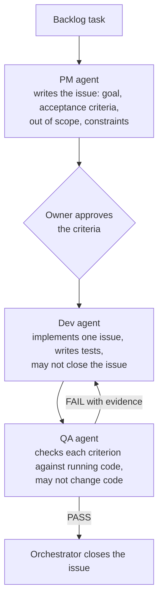

# Agent workflow

How the app was built by AI agents, what each tool did, and what stayed with me.

[Back to overview](../README.md)

## Which tool did what

| Phase | Tool | AI contribution | My contribution |
|---|---|---|---|
| Product specification | Microsoft 365 Copilot | Drafted the specification, data model and API outline from my descriptions | Defined the problem, scope, workflows and non-goals; accepted or rejected each proposal |
| Frontend | Lovable | Generated the React screens | Described the screens and rules; later had the generated service layer reshaped to match the API contract |
| Architecture options | Claude Code | Laid out options and trade-offs for stack, storage, login and deployment | Chose one option in each case |
| Backend implementation | Claude Code agent team | Groomed issues, wrote code and tests, checked results | Approved acceptance criteria and every contract or dependency change |
| Deployment and observability | Claude Code | Wrote infrastructure templates, pipelines, telemetry and dashboards | Chose hosting, environments, alert rule and thresholds; ran the cloud accounts |
| Operations | Claude Code, headless | Investigates alerts | Reviews and merges any proposed fix; deploys |

## The agent team

The team pattern comes from the AI Dev Tools Zoomcamp: one orchestrator and three specialised agents, each with its own short role file.

Three rules make the split useful:

- **The PM writes criteria that can be checked by looking at the result.** Anything moved out of scope becomes a linked follow-up issue, so nothing is dropped silently.
- **The developer cannot change the criteria or close its own issue.** If a criterion is wrong or contradictory, it comments on the issue.
- **QA ignores what the implementation claims.** It tests the running code against the criteria, reports PASS or FAIL per criterion, and fixes nothing.

Each task is a GitHub issue, so the grooming, the implementation notes and the QA verdict are recorded where the work happened.

## The rules I set for every agent

These sit in the repository's agent instructions and apply to all tools.

**Sources of truth, in order.** Product specification, then API contract (OpenAPI), then database schema, then architecture. When documents conflict, the higher one wins.

**Decision authority.**
- AI tools may recommend but never decide.
- Project files contain only what I have explicitly decided. A stated preference is not a decision.
- If something a task needs is undecided, stop and ask.

**Stop and ask before** deleting important data, force-pushing, modifying external systems, any destructive operation, or adding a dependency.

**Working rules.**
- Reproduce a reported problem before explaining it.
- No undocumented endpoints: the API contract changes first, with approval, then the code.
- A bug fix starts with a test that reproduces the bug.
- Touch only what the task needs; mention unrelated problems instead of fixing them.
- Record every AI contribution in a usage report.

## How I verified the work

I did not review the code line by line. Verification was built into the process:

1. **Acceptance criteria first.** Every task had criteria I approved before implementation, including the awkward cases.
2. **One test per criterion.** Backend tests run against a real PostgreSQL database, not mocks.
3. **Independent QA.** A separate agent, with no stake in the implementation, checked each criterion against the running code.
4. **Contract checks.** The API contract was written before the endpoints, and the frontend client was checked against it.
5. **Whole-system tests.** Integration tests over HTTP against the Docker stack, and a browser end-to-end test, run in CI on every push.
6. **Drills on prod.** Deployment, alerting and rollback were exercised for real, not assumed.

## The usage report

The private repository keeps a report of every AI contribution, written as the work happened. Each entry records what I decided, what the agent did, and how it was checked. One entry, shortened:

> **Registration, login and logout.** The owner groomed the task and approved its acceptance criteria, including the contract changes and the password-hashing library. The agent made the approved contract changes, then wrote the endpoints and a test for every criterion. The first test run exposed a mistake in a new test, which the agent fixed. QA then found that a request body that is not valid UTF-8 was answered with the framework's own error instead of the app's error format. The agent added a test that reproduced it, fixed it, and the suite passed.

That report is the source for the examples in [Reflection](reflection.md).
