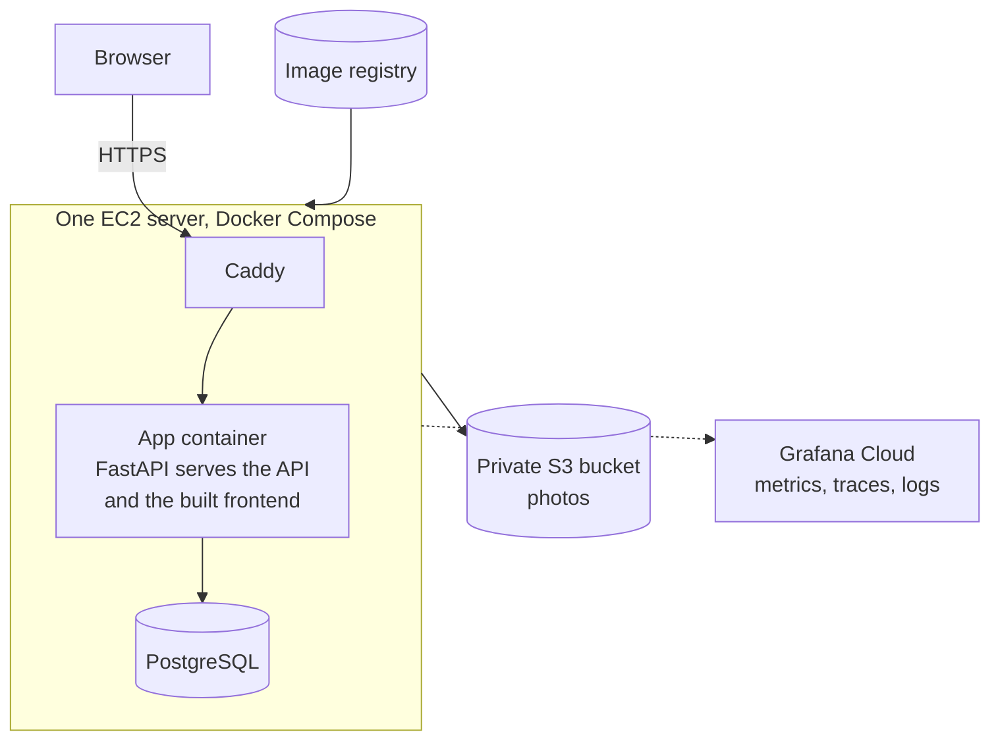
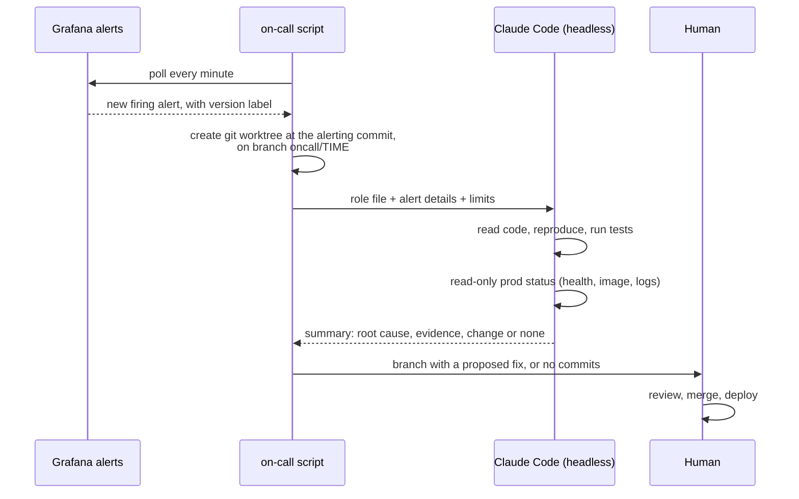

# Operations

Deployment, monitoring, alerting and the on-call agent.

[Back to overview](../README.md)

## Deployment



- **Everything is created from one CloudFormation template:** the server with a fixed address, the image registry, the server's permissions, a firewall open only on ports 80 and 443, the private photo bucket and a daily disk snapshot kept for 7 days.
- **No stored keys.** The server reaches storage, the registry and secrets through its role. GitHub Actions signs in through OIDC, limited to the main branch of the repository. Secrets live in a parameter store, never in the repository.
- **Shell access without SSH,** through the cloud provider's session manager.
- **Cost:** about $13 a month.

## Pipeline

1. **Every push:** backend and frontend tests in parallel, then integration and browser end-to-end tests against the Docker stack.
2. **On main, after all tests pass:** build one image and push it, tagged with build time and commit.
3. **Deploy to prod is manual:** it starts an already-built image, then checks the health endpoint. Nothing is rebuilt at deploy time.
4. **Rollback is the same workflow** with an older image tag.

## Observability

- **Traces and HTTP metrics** for every request through OpenTelemetry.
- **Application metrics** chosen for user impact: artworks created, artwork creation failures, photos uploaded, active users and relationship explorations.
- **Structured JSON logs** carrying the trace and span of the request. Logs hold no customer data: no email, password, title, note or search text. A test enforces this.
- **Every signal carries the environment and the deployed version,** so a dashboard or alert can be filtered to one release.
- **One dashboard** in Grafana Cloud for dev and prod; the same stack can run locally for offline work.

## Alerting

One alert, on the workflow that matters most: **artwork creations are failing.**

- It counts only the app's own failures, such as a server error or unreachable storage. User input errors do not count.
- It fires on one failure within 15 minutes. I chose this over "three in ten minutes" because with little traffic a blocked user may try only once or twice.
- It names the service, environment, version, owner, a runbook and a link to the dashboard filtered to that release.

## The on-call agent



**What it may do:** read and edit files in its own worktree, run the tests, call HTTP endpoints, use git locally, and run one read-only script that reports prod's health, running image and recent logs.

**What it may not do:** push or merge, deploy, roll back, change infrastructure, or change production data.

The limits are enforced by the tool allowlist the script passes to the agent, not only by instructions:

```python
ALLOWED_TOOLS = ["Read", "Grep", "Glob", "Edit", "Write",
                 "Bash(uv run:*)", "Bash(uv sync:*)", "Bash(curl:*)", "Bash(ls:*)",
                 "Bash(git status:*)", "Bash(git diff:*)", "Bash(git log:*)", "Bash(git show:*)",
                 "Bash(git add:*)", "Bash(git commit:*)", f"Bash({PROD_STATUS}:*)"]
```

Other design points:

- **It starts at the alerting version.** The alert carries the image tag, which contains the commit, so the agent investigates the code that is actually failing, not whatever is newest.
- **Each alert episode is handled once.** Handled alerts are remembered across restarts.
- **Every session is logged in full** for later review.
- **It runs locally** on my Claude Code login. This was the least costly version; a cloud version (alert to queue, short-lived container job) can reuse the same role file.

## Drills on prod, 26 October 2026

**Alert drill**
1. A fault switch made artwork creation fail on prod; two attempts returned a server error.
2. The alert fired for prod and the email arrived.
3. The on-call agent started. In about 2 minutes it named the fault switch as the likely cause, from the git history, the timing and the failure count. It ran the tests, which passed, and committed nothing because the code had no bug.
4. The drill showed the agent could not confirm the switch on prod. I had a read-only prod status script added and allowed the agent to run it.

**Rollback drill**
1. Checked that no database migration had changed since the previous image.
2. Deployed the previous image: healthy in about 1 minute, and the dashboard showed the old version.
3. Deployed the current image again: healthy.

Both drills used an injected fault or a planned rollback. The system has not handled an unplanned incident.
